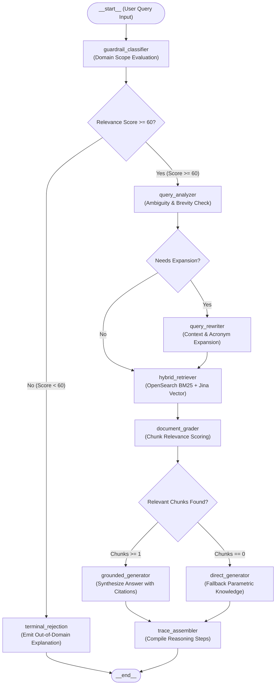
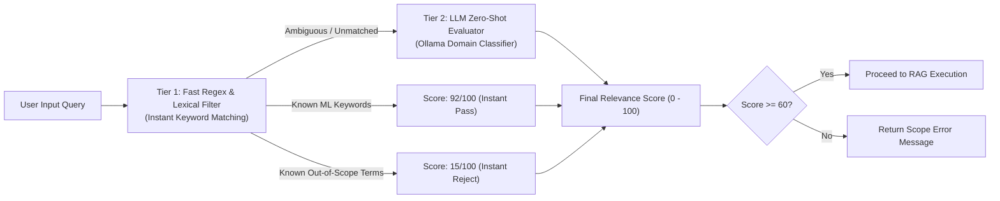

# Agent Workflow Specifications

This document defines the agentic decision loops, state machine schemas, guardrail policies, adaptive query rewriting heuristics, and document grading mechanics used across the research assistant service.

---

## 1. Agent Paradigm & LangGraph State Routing

The Agentic RAG microservice extends traditional single-pass retrieval by introducing autonomous evaluation gates, feedback loops, and conditional routing.



---

## 2. Agent State Schema

The agent operates across a typed state dictionary (`AgentState`) preserved through all graph transitions:

```python
from typing import Any, List, Optional
from typing_extensions import TypedDict


class AgentState(TypedDict):
    """Execution state tracked across agent nodes."""

    # Input parameters
    query: str
    top_k: int
    use_hybrid: bool
    model: str
    categories: Optional[List[str]]

    # Guardrail and analysis
    guardrail_score: int
    is_in_domain: bool

    # Query reformulation
    rewritten_query: Optional[str]
    retrieval_attempts: int

    # Retrieval and grading
    documents: List[dict]
    graded_documents: List[dict]
    sources: List[str]

    # Generation and tracking
    generation: str
    reasoning_steps: List[str]
    search_mode: str
```

---

## 3. Input Guardrail & Domain Scope Classifier

To prevent off-topic model drift, prompt injection, or misuse on non-scientific questions, all incoming queries must pass through a two-tiered domain filter.

### 3.1 Two-Tiered Guardrail Architecture



### 3.2 Tier 1: Fast Heuristic Rules

- **Allowed Domain Lexicon**:
  `attention`, `transformer`, `bert`, `gpt`, `model`, `learning`, `neural`, `ai`, `algorithm`, `paper`, `arxiv`, `nlp`, `llm`, `deep`, `embedding`, `search`, `rag`, `training`, `parameter`, `self-attention`, `layer`, `architecture`, `diffusion`, `loss`, `gradient`, `weights`.
  *Matches immediately receive a baseline score of 92/100.*

- **Disallowed Out-of-Scope Lexicon**:
  `dog`, `cat`, `weather`, `capital`, `france`, `president`, `recipe`, `cook`, `pizza`, `car`, `movie`, `song`, `football`, `soccer`, `nfl`, `biology`, `animal`.
  *Matches without machine learning overlap immediately receive a score of 15/100.*

### 3.3 Tier 2: Zero-Shot LLM Guardrail Scoring

For queries not decisively categorized by Tier 1 heuristics, an isolated prompt evaluates domain relevance:

```text
You are an input guardrail for an arXiv Computer Science & AI research assistant.
Rate the relevance of this question to CS/AI/ML research on a scale of 0 to 100: '{query}'
Respond ONLY with a single integer number between 0 and 100.
```

- **Relevance Threshold**: `60 / 100`
- **Rejection Behavior**:
  If `score < 60`, execution halts immediately without querying OpenSearch. The client receives an explanatory response citing the guardrail score and directing them toward CS/AI research queries.

---

## 4. Adaptive Query Rewriting & Expansion Logic

User queries often contain ambiguous jargon, contractions, or brevity that degrades dense vector and BM25 retrieval recall. The query analyzer checks query length and vagueness:

### 4.1 Expansion Conditions
A query is routed to `query_rewriter` when:
1. Word count is $\le 5$ words, and
2. Contains colloquial or ambiguous tokens: `"stuff"`, `"tell me about"`, `"basics"`, `"things"`.

### 4.2 Expansion Mapping Heuristics

| User Query | Detected Topic | Rewritten Query for OpenSearch | Rationale |
| :--- | :--- | :--- | :--- |
| `"Tell me about ML stuff"` | Machine Learning | `"machine learning core algorithms and foundations"` | Targets canonical ML papers and foundational overviews |
| `"Tell me about transformer basics"` | Transformer Architectures | `"transformer architecture and self-attention mechanisms"` | Optimizes BM25 and vector alignment for attention research |
| `"<short query>"` | General CS/AI | `"<query> research papers and concepts"` | Adds academic retrieval context |

When query rewriting triggers, `retrieval_attempts` is incremented to `2`, and the reason is recorded in `reasoning_steps`.

---

## 5. Document Grading & Grounded Answer Generation

### 5.1 Document Grader
The document grading module inspects chunks returned from OpenSearch hybrid search:
- **Length Normalization**: Truncates raw chunks $>1200$ characters to prevent context window overflow while preserving key theorems and abstracts.
- **Deduplication**: Extracts unique paper arXiv IDs (stripping version identifiers, e.g. `2301.00234v2` $\rightarrow$ `2301.00234`) to construct verified PDF source links (`https://arxiv.org/pdf/{arxiv_id}.pdf`).

### 5.2 Structured Grounding Prompt
When valid chunks are graded, they are formatted into a structured prompt enforcing factual citations:

```text
You are an expert research assistant specializing in Computer Science and Artificial Intelligence.
Answer the user's question accurately using ONLY the provided research paper contexts.
Cite paper identifiers where appropriate.

Contexts:
[1] arXiv:1706.03762 - Attention Is All You Need:
...
[2] arXiv:2005.14165 - Language Models are Few-Shot Learners:
...

Question: {query}
Answer:
```

### 5.3 Fallback Mechanics
- **Model Fallback**: If inference with a larger model fails (e.g. timeout or memory constraints), the system automatically falls back to `llama3.2:1b`.
- **Zero Document Fallback**: If OpenSearch returns 0 chunks, the agent branches to parametric generation while explicitly notifying the user that no specific arXiv context was found.

