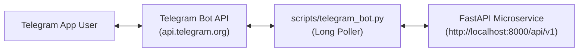

# API & Integration Reference Guide

This document provides complete technical specifications for the REST endpoints, the Gradio interactive web UI, and the Telegram bot service.

---

## 1. REST API Specification

Base URL: `http://localhost:8000/api/v1`  
OpenAPI Documentation: `http://localhost:8000/docs`  
OpenAPI Specification JSON: `http://localhost:8000/openapi.json`

---

### 1.1 Health Check Endpoint (`GET /health`)

Verifies service liveness and checks active connections to PostgreSQL, OpenSearch, Ollama, and Redis.

- **URL**: `/api/v1/health`
- **Method**: `GET`
- **Authentication**: None

#### Response Model (`HealthResponse`)
```json
{
  "status": "ok",
  "version": "0.1.0",
  "environment": "development",
  "service_name": "rag-api",
  "services": {
    "database": {
      "status": "healthy",
      "message": "Connected successfully"
    },
    "opensearch": {
      "status": "healthy",
      "message": "Index 'arxiv-papers-chunks' with 1248 documents"
    },
    "ollama": {
      "status": "healthy",
      "message": "Ollama service operational"
    }
  }
}
```

#### Status Codes
- `200 OK`: All services operational (`status: "ok"` or `"degraded"` if secondary service is degraded).
- `500 Internal Server Error`: Critical infrastructure failure.

#### Example Usage
```bash
curl -X GET http://localhost:8000/api/v1/health
```

---

### 1.2 Standard RAG Endpoint (`POST /ask`)

Executes an exact-match cache lookup, followed by OpenSearch hybrid retrieval and Ollama response synthesis.

- **URL**: `/api/v1/ask` (also accepts `/api/v1/ask/`)
- **Method**: `POST`
- **Content-Type**: `application/json`

#### Request Schema (`AskRequest`)
| Parameter | Type | Required | Default | Description |
| :--- | :--- | :--- | :--- | :--- |
| `query` | `string` | **Yes** | — | Question to ask (1 to 1000 characters) |
| `top_k` | `integer` | No | `3` | Number of chunks to retrieve (1 to 10) |
| `use_hybrid` | `boolean` | No | `true` | Combine BM25 keyword + dense vector search |
| `model` | `string` | No | `"llama3.2:1b"` | Ollama LLM identifier |
| `categories` | `list[string]` | No | `null` | Filter by arXiv tags (e.g. `["cs.AI", "cs.LG"]`) |

#### Request Example
```json
{
  "query": "What are attention mechanisms in neural networks?",
  "top_k": 3,
  "use_hybrid": true,
  "model": "llama3.2:1b",
  "categories": ["cs.AI", "cs.LG"]
}
```

#### Response Model (`AskResponse`)
```json
{
  "query": "What are attention mechanisms in neural networks?",
  "answer": "Attention mechanisms allow models to focus dynamically on different regions of an input sequence, computing soft-alignment scores through query, key, and value vectors...",
  "sources": [
    "https://arxiv.org/pdf/1706.03762.pdf",
    "https://arxiv.org/pdf/2005.14165.pdf"
  ],
  "chunks_used": 3,
  "search_mode": "hybrid"
}
```

#### Example Usage (cURL)
```bash
curl -X POST http://localhost:8000/api/v1/ask \
  -H "Content-Type: application/json" \
  -d '{
    "query": "What are attention mechanisms?",
    "top_k": 3,
    "use_hybrid": true,
    "model": "llama3.2:1b"
  }'
```

#### Example Usage (Python `httpx`)
```python
import httpx

payload = {
    "query": "Explain LoRA parameter-efficient fine-tuning",
    "top_k": 3,
    "use_hybrid": True,
    "model": "llama3.2:1b"
}

with httpx.Client(base_url="http://localhost:8000/api/v1", timeout=60.0) as client:
    response = client.post("/ask", json=payload)
    data = response.json()
    print("Answer:", data["answer"])
    print("Sources:", data["sources"])
```

---

### 1.3 Agentic RAG Endpoint (`POST /agentic_ask`)

Executes the intelligent agentic loop: guardrail classification, query reformulation, adaptive retrieval, and grounded synthesis with full reasoning trace.

- **URL**: `/api/v1/agentic_ask` (also accepts `/api/v1/ask-agentic`)
- **Method**: `POST`
- **Content-Type**: `application/json`

#### Request Schema
Identical to `AskRequest` (`query`, `top_k`, `use_hybrid`, `model`, `categories`).

#### Successful Response Model (`AgenticAskResponse`)
```json
{
  "query": "Tell me about ML stuff",
  "answer": "Machine learning focuses on statistical algorithms that learn patterns from data. Key pillars include supervised learning, unsupervised representations, and deep neural architectures...",
  "sources": [
    "https://arxiv.org/pdf/2301.00234.pdf",
    "https://arxiv.org/pdf/2205.12345.pdf"
  ],
  "retrieval_attempts": 2,
  "reasoning_steps": [
    "Validated query relevance (score: 92/100 - passed)",
    "Rewrote query for better retrieval: 'machine learning core algorithms and foundations'",
    "Retrieved 3 candidate document chunks from OpenSearch",
    "Synthesized grounded answer with citations"
  ],
  "rewritten_query": "machine learning core algorithms and foundations",
  "search_mode": "hybrid"
}
```

#### Guardrail Rejection Response (Out-of-Scope Query)
When a non-CS/AI query is submitted (e.g., *"What is the recipe for chocolate cake?"*):
```json
{
  "query": "What is the recipe for chocolate cake?",
  "answer": "I apologize, but this question is out of scope for the arXiv Research Assistant. (Guardrail Score: 15/100 - The query is not related to Computer Science, Artificial Intelligence, or Machine Learning research).\n\nPlease ask questions related to CS/AI research papers.",
  "sources": [],
  "retrieval_attempts": 0,
  "reasoning_steps": [
    "Validated query relevance (score: 15/100 - rejected: out of scope)"
  ],
  "rewritten_query": null,
  "search_mode": "none"
}
```

#### Example Usage (cURL)
```bash
curl -X POST http://localhost:8000/api/v1/agentic_ask \
  -H "Content-Type: application/json" \
  -d '{
    "query": "How do transformer attention heads learn features?",
    "top_k": 3,
    "use_hybrid": true
  }'
```

---

### 1.4 Streaming RAG Endpoint (`POST /stream`)

Streams LLM tokens via Server-Sent Events (SSE). Emits metadata as initial event, followed by text delta chunks, and a completion event.

- **URL**: `/api/v1/stream` (also accepts `/api/v1/stream/`)
- **Method**: `POST`
- **Content-Type**: `application/json`
- **Accept**: `text/plain`

#### Stream Event Progression
```
data: {"sources": ["https://arxiv.org/pdf/1706.03762.pdf"], "chunks_used": 3, "search_mode": "hybrid"}

data: {"chunk": "Transformers "}

data: {"chunk": "are "}

data: {"chunk": "deep "}

data: {"chunk": "learning "}

data: {"chunk": "models..."}

data: {"answer": "Transformers are deep learning models...", "done": true}
```

---

### 1.5 Direct Hybrid Search Endpoint (`POST /search`)

Provides direct access to the OpenSearch index without generating LLM responses.

- **URL**: `/api/v1/search`
- **Method**: `POST`
- **Payload**:
```json
{
  "query": "diffusion models image generation",
  "size": 5,
  "use_hybrid": true,
  "categories": ["cs.CV", "cs.AI"]
}
```

---

## 2. Gradio Web Interface Guide

The repository includes a responsive Gradio interface (`src/gradio_app.py`) served via launcher script `gradio_launcher.py`.

### 2.1 Interface Capabilities
- **Real-Time Token Streaming**: Consumes `/api/v1/stream` using asynchronous HTTP SSE streams.
- **Dynamic Retrieval Tuning**: Sliders for `top_k` chunk control (1 to 10).
- **Hybrid Search Toggle**: Enables or disables dense vector scoring.
- **Model Selector**: Switch dynamically between configured Ollama models (`llama3.2:1b`, `llama3.2:3b`, `llama3.1:8b`, `qwen2.5:7b`).
- **arXiv Category Filter**: Restrict searches to `cs.AI`, `cs.LG`, `cs.CL`, `cs.CV`, or `cs.NE`.
- **Source Citation Links**: Automatically parses sources into direct hyperlinks to `https://arxiv.org/pdf/{arxiv_id}.pdf`.

### 2.2 Launching the Gradio Web App

```bash
# Ensure FastAPI backend is running first
python gradio_launcher.py
```

The interface starts on port `7861` by default:
```
🚀 Starting arXiv Paper Curator Gradio Interface...
📡 API Base URL: http://127.0.0.1:8000/api/v1
Running on local URL: http://0.0.0.0:7861
```

---

## 3. Telegram Bot Service Guide

A production-ready Telegram bot client is provided in `scripts/telegram_bot.py`. It integrates seamlessly with the microservice using long-polling, requiring zero open inbound ports on the host.

### 3.1 Architecture Overview



### 3.2 Setup & Configuration

1. **Obtain Bot Token**:
   - Message `@BotFather` on Telegram.
   - Run `/newbot` and follow the prompts to choose a bot name and username.
   - Copy the generated API token (e.g. `123456789:ABCdefGhIJKlmNoPQRsTUVwxyZ`).

2. **Configure Environment**:
   Add to `.env` or export directly:
   ```bash
   export TELEGRAM_BOT_TOKEN="123456789:ABCdefGhIJKlmNoPQRsTUVwxyZ"
   export RAG_API_URL="http://localhost:8000/api/v1"
   ```

3. **Start the Bot Service**:
   ```bash
   python scripts/telegram_bot.py --token "YOUR_TELEGRAM_BOT_TOKEN"
   ```

### 3.3 Available Commands

| Command | Action | API Route Used |
| :--- | :--- | :--- |
| `/start` | Displays welcome banner and feature overview | Local |
| `/help` | Explains how to query research papers | Local |
| `/status` | Fetches microservice and database health | `GET /api/v1/health` |
| `/ask <query>` | Fast retrieval and standard RAG answer | `POST /api/v1/ask` |
| `/agentic <query>` | Full agentic reasoning with citations | `POST /api/v1/agentic_ask` |
| `<free text>` | Defaults to agentic RAG analysis | `POST /api/v1/agentic_ask` |

### 3.4 Production Daemonization (Systemd Service)

To run the Telegram bot continuously in production:

```ini
# /etc/systemd/system/rag-telegram-bot.service
[Unit]
Description=arXiv Agentic RAG Telegram Bot Service
After=network.target

[Service]
Type=simple
User=raguser
WorkingDirectory=/opt/agentic-rag-research-assistant
EnvironmentFile=/opt/agentic-rag-research-assistant/.env
ExecStart=/opt/agentic-rag-research-assistant/.venv/bin/python scripts/telegram_bot.py
Restart=always
RestartSec=5

[Install]
WantedBy=multi-user.target
```

Enable and start the service:
```bash
sudo systemctl daemon-reload
sudo systemctl enable rag-telegram-bot
sudo systemctl start rag-telegram-bot
```

