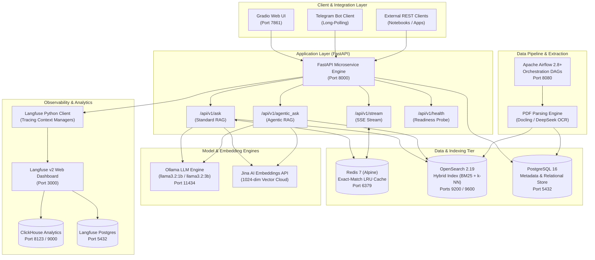
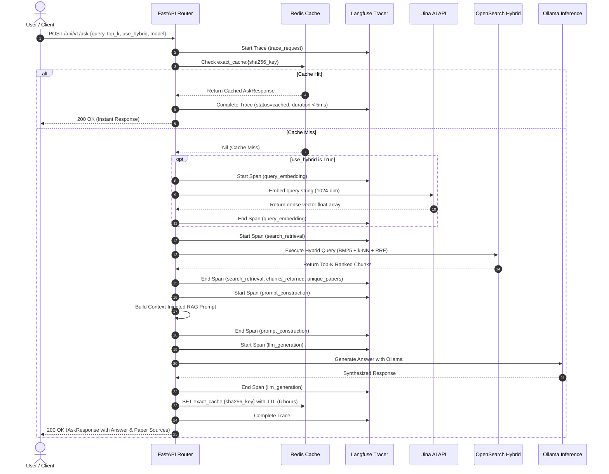
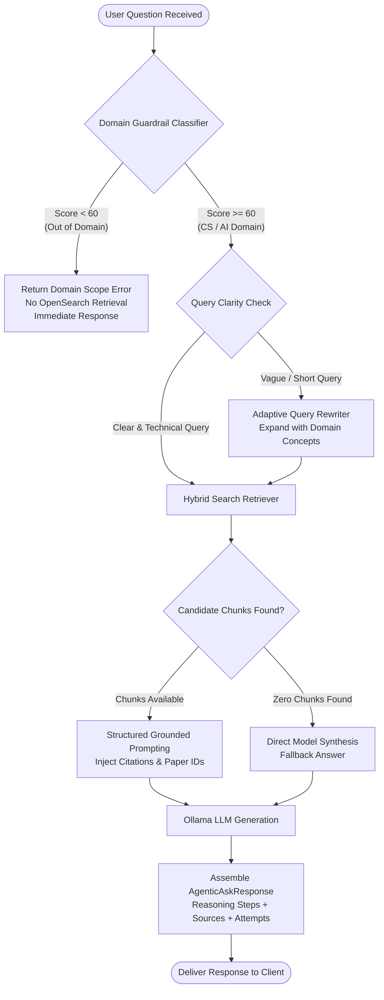
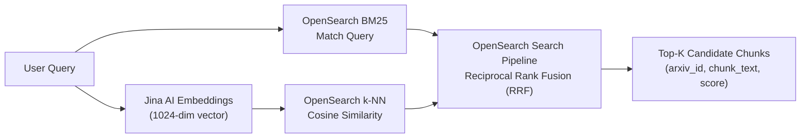
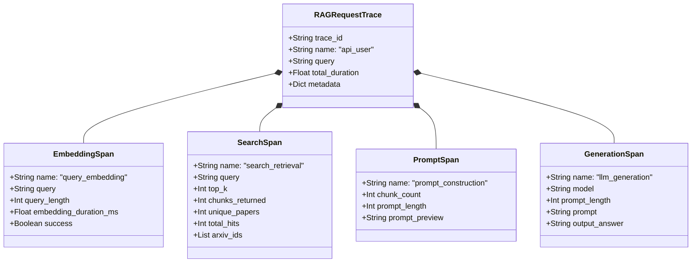

# System Architecture & Data Flow

This document details the architectural topology, service interactions, retrieval pipelines, exact-match caching layer, and observability framework powering the production Agentic RAG microservice.

---

## 1. High-Level Architectural Topology

The system is engineered as an enterprise-grade, microservice-based Retrieval-Augmented Generation (RAG) platform specialized for Computer Science and Artificial Intelligence research papers from arXiv.



---

## 2. Core Service Topology

The complete infrastructure is orchestrated through Docker Compose:

| Service | Container Name | Image / Base | Internal Port | Host Port | Role |
| :--- | :--- | :--- | :--- | :--- | :--- |
| **API** | `rag-api` | Python 3.12 (Custom) | 8000 | 8000 | FastAPI REST service, routing, business logic |
| **Redis** | `rag-redis` | `redis:7-alpine` | 6379 | 6379 | Sub-second exact-match response caching |
| **OpenSearch** | `rag-opensearch` | `opensearchproject/opensearch:2.19.0` | 9200, 9600 | 9200, 9600 | Vector database + BM25 keyword search index |
| **OpenSearch Dashboards** | `rag-dashboards` | `opensearchproject/opensearch-dashboards:2.19.0` | 5601 | 5601 | Search index management and visualization |
| **Ollama** | `rag-ollama` | `ollama/ollama:0.11.2` | 11434 | 11434 | Local inference engine (Llama-3.2, Qwen, etc.) |
| **PostgreSQL** | `rag-postgres` | `postgres:16-alpine` | 5432 | 5432 | arXiv paper metadata and ingestion state |
| **Langfuse** | `rag-langfuse` | `langfuse/langfuse:2` | 3000 | 3000 | LLM observability, trace visualizer, span monitor |
| **Langfuse Postgres** | `rag-langfuse-postgres` | `postgres:16-alpine` | 5432 | Internal | Dedicated relational store for Langfuse state |
| **ClickHouse** | `rag-clickhouse` | `clickhouse/clickhouse-server:24.8-alpine` | 8123, 9000 | Internal | High-performance analytics backend for Langfuse |
| **Airflow** | `rag-airflow` | Apache Airflow (Custom) | 8080 | 8080 | Scheduled metadata ingestion and PDF indexing |

---

## 3. Query Pipelines & Data Flows

### 3.1 Standard RAG Query Flow (`/api/v1/ask`)

The standard RAG pipeline prioritizes rapid response times by first querying the exact-match cache and falling back to OpenSearch hybrid search:



### 3.2 Agentic RAG Flow (`/api/v1/agentic_ask`)

The agentic pipeline enforces strict quality gates, domain validation, and adaptive query reformulation:



---

## 4. Hybrid Search Architecture

The search service utilizes an OpenSearch single hybrid index (`arxiv-papers-chunks`) configured with dense vector k-NN and sparse BM25 inverted indexes.

### 4.1 Hybrid Search Pipeline Mechanics

1. **Sparse Lexical Search (BM25)**:
   - Matches exact keywords, technical terms, symbols, and author metadata.
   - Evaluates term frequency and inverse document frequency over fields `chunk_text`, `title`, and `abstract`.

2. **Dense Vector Search (k-NN)**:
   - Encodes user query into a 1024-dimensional normalized vector via Jina AI (`jina-embeddings-v2-base-en`).
   - Searches `chunk_vector` using cosine similarity (`cosinesimil` space type) with HNSW (Hierarchical Navigable Small World) index graphs.

3. **Reciprocal Rank Fusion (RRF)**:
   - Combines ranked lists from the vector query and BM25 query into a unified relevance score:
     $$RRF\_Score(d) = \sum_{m \in M} \frac{1}{k + r_m(d)}$$
     where $k = 60$, and $r_m(d)$ is the document rank within model $m$.
   - Eliminates score scale differences between cosine similarity $[0, 1]$ and unbounded BM25 scores.



---

## 5. Exact-Match Redis Caching Architecture

To achieve production-grade throughput and eliminate redundant LLM inference costs, the microservice implements an exact-match caching layer backed by Redis 7.

### 5.1 Cache Key Generation

Cache keys are constructed deterministically from all parameters that affect generation output:

```python
key_data = {
    "query": request.query.strip(),
    "model": request.model,
    "top_k": request.top_k,
    "use_hybrid": request.use_hybrid,
    "categories": sorted(request.categories) if request.categories else [],
}
key_string = json.dumps(key_data, sort_keys=True)
key_hash = hashlib.sha256(key_string.encode()).hexdigest()[:16]
cache_key = f"exact_cache:{key_hash}"
```

### 5.2 Performance Profile & Invalidation

- **Cache Hit Latency**: **1 to 5 milliseconds** ($>100\times$ speedup compared to $12\text{--}25$ seconds cold LLM generation).
- **Time-to-Live (TTL)**: 6 hours (`ttl_hours = 6` default, configurable via `REDIS__TTL_HOURS`).
- **Memory Management**: Redis configured with `maxmemory 256mb` and `maxmemory-policy allkeys-lru` (Least Recently Used eviction policy prevents out-of-memory under high load).
- **Fault-Tolerant Bypass**: If Redis is unreachable or returns a serialization error, the request automatically falls back to full pipeline execution without failing the user request.

---

## 6. Langfuse Observability & Tracing Architecture

Every interaction with the microservice is traced through self-hosted Langfuse v2, providing end-to-end visibility into latencies, token consumption, and retrieval quality.



### Trace Span Hierarchy
1. **`trace_request`**: Root trace recording user identifier, query text, total execution latency, and success/failure state.
2. **`query_embedding`**: Captures embedding generation time and vector dimensions.
3. **`search_retrieval`**: Records OpenSearch execution time, total documents matched, chunks returned, and paper IDs.
4. **`prompt_construction`**: Records token/character length of the synthesized prompt and chunk count.
5. **`llm_generation`**: Captures the exact model version used, full prompt sent, and final generation tokens.

