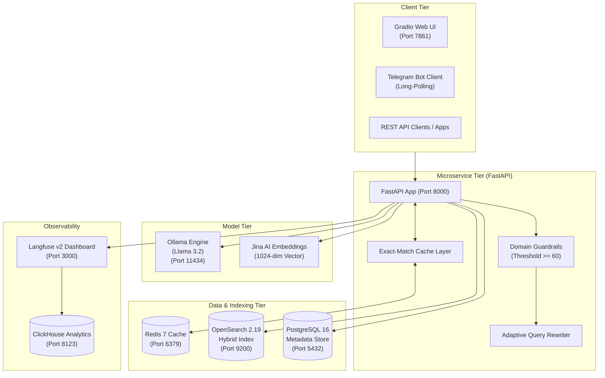

# arXiv Agentic RAG Research Assistant

[](https://fastapi.tiangolo.com)
[](https://opensearch.org/)
[](https://redis.io/)
[](https://ollama.com/)
[](https://langfuse.com/)
[](https://gradio.app/)
[](https://python.org/)

An enterprise-ready, containerized Agentic Retrieval-Augmented Generation (RAG) microservice purpose-built for Computer Science and Artificial Intelligence research papers from arXiv. 

The system pairs **hybrid search** (sparse BM25 + dense Jina AI vector embeddings combined via Reciprocal Rank Fusion) with **sub-second Redis exact-match caching**, **Langfuse v2 tracing**, **LangGraph-driven agentic state workflows**, and multi-channel client interfaces (REST, Gradio, and Telegram).

---

## Key Features

- **Agentic Decision Workflows**: Two-tiered input guardrails (heuristic + zero-shot LLM scoring), adaptive query rewriting for vague user queries, and document grading with hallucination mitigation.
- **Hybrid Search Engine**: OpenSearch single hybrid index combining lexical BM25 matching and 1024-dimensional dense vectors with Reciprocal Rank Fusion (RRF).
- **Exact-Match Redis Caching**: Sub-second query delivery ($3\text{--}5\text{ ms}$, over $100\times$ faster than cold LLM generation) with deterministic SHA-256 parameter hashing and LRU memory eviction.
- **Full-Stack Observability**: Self-hosted Langfuse v2 tracing capturing execution trees, retrieval relevance, prompt construction, and token generation latencies.
- **Multi-Modal Client Interfaces**:
  - **REST API**: Production OpenAPI endpoints for standard RAG, agentic RAG, and SSE streaming.
  - **Gradio Web Application**: Interactive chat interface with real-time token streaming and dynamic retrieval filters.
  - **Telegram Bot Service**: Long-polling assistant bot for mobile and desktop queries.
- **Automated Data Ingestion**: Apache Airflow DAGs managing arXiv paper harvesting, Docling/DeepSeek OCR parsing, and chunk indexing.

---

## System Architecture



---

## Quick Start Guide

### 1. Configure Environment
```bash
# Clone the repository
git clone https://github.com/your-org/agentic-rag-research-assistant.git
cd agentic-rag-research-assistant

# Create environment file from template
cp .env.example .env
```
Provide your Jina AI API key and Langfuse credentials in `.env`:
```ini
JINA_API_KEY=your_jina_key_here
```

### 2. Start Services via Docker Compose
```bash
docker compose up --build -d
```

### 3. Pull Ollama Model
```bash
docker exec -it rag-ollama ollama pull llama3.2:1b
```

### 4. Verify System Health
```bash
curl -s http://localhost:8000/api/v1/health | jq .
```

---

## Interfaces & Usage

### 1. REST API
- **Standard RAG**: `POST /api/v1/ask`
- **Agentic RAG**: `POST /api/v1/agentic_ask` (or `/api/v1/ask-agentic`)
- **Token Streaming**: `POST /api/v1/stream`
- **Health Probe**: `GET /api/v1/health`

#### Example Agentic Request
```bash
curl -X POST http://localhost:8000/api/v1/agentic_ask \
  -H "Content-Type: application/json" \
  -d '{
    "query": "Tell me about ML stuff",
    "top_k": 3,
    "use_hybrid": true
  }'
```

### 2. Gradio Web Interface
Start the interactive web dashboard on port `7861`:
```bash
python gradio_launcher.py
```
Open your browser at `http://localhost:7861` to query papers with real-time streaming answers.

### 3. Telegram Bot Service
Run the Telegram assistant bot:
```bash
python scripts/telegram_bot.py --token "YOUR_TELEGRAM_BOT_TOKEN"
```

---

## Performance & Benchmarking

| Pipeline Phase | Cold Execution (Cache Miss) | Warm Execution (Cache Hit) | Acceleration Factor |
| :--- | :--- | :--- | :--- |
| **Response Latency** | $12.4\text{--}18.5\text{ seconds}$ | **$0.003\text{--}0.005\text{ seconds}$** | **$>100\times$ faster** |
| **Database Load** | Full BM25 + k-NN Search | Zero database load | $100\%$ offloaded |
| **LLM Inference** | Full token generation | Zero inference cost | $100\%$ compute saved |

---

## Detailed Documentation Directory

For deep-dive technical references, architectural specs, and operational guides, refer to the documents in `docs/`:

1. [**System Architecture & Data Flow**](docs/ARCHITECTURE_AND_DATA_FLOW.md): Detailed breakdowns of query pipelines, hybrid search mechanisms, exact-match Redis caching, and Langfuse span tracing hierarchies.
2. [**API & Integration Reference**](docs/API_AND_INTEGRATION_REFERENCE.md): Technical guides for all REST endpoints, request/response models, Gradio interface controls, and Telegram bot configuration.
3. [**Agent Workflow Specifications**](docs/AGENT_WORKFLOW_SPECIFICATIONS.md): LangGraph state graph schemas, input guardrail classifiers (scoring criteria), query rewriter rules, and document grader logic.
4. [**Operations & Benchmarking Guide**](docs/OPERATIONS_AND_BENCHMARKING.md): Step-by-step developer onboarding, Docker container topology, Redis cache administration, Langfuse analytics, and test execution.
5. [**DeepSeek OCR Engine Setup**](docs/DEEPSEEK_OCR_SETUP.md): Hardware requirements and configuration for high-throughput PDF parsing.

---

## License

This project is licensed under the Apache 2.0 License. See [LICENSE](LICENSE) for details.

